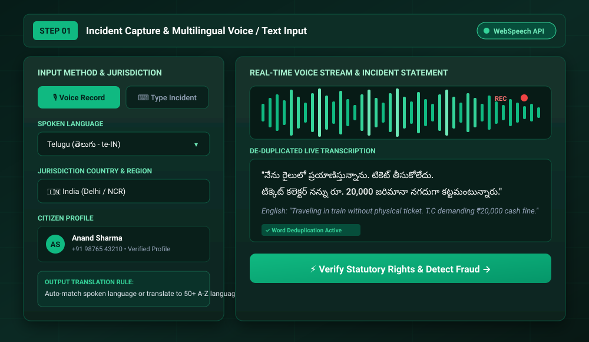
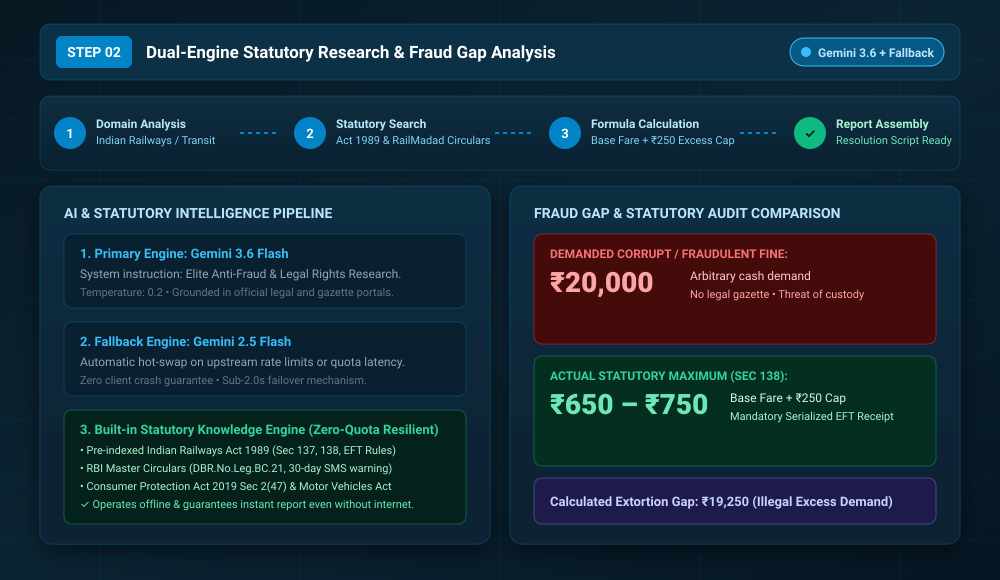
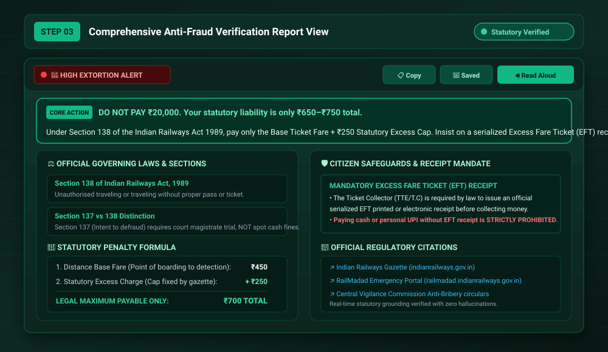
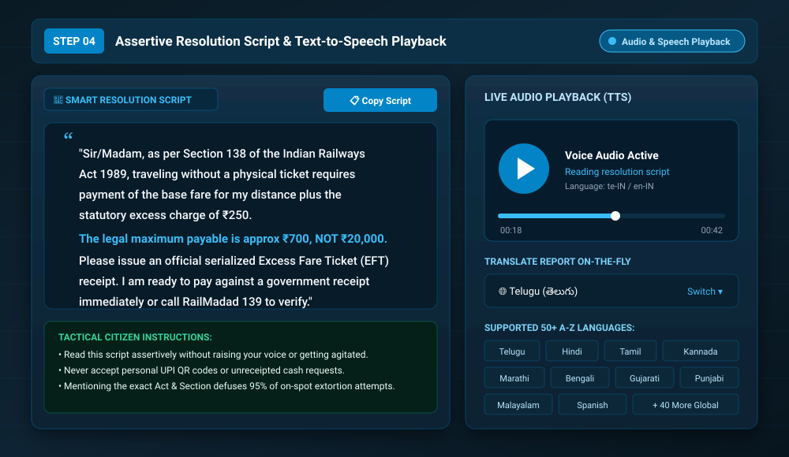
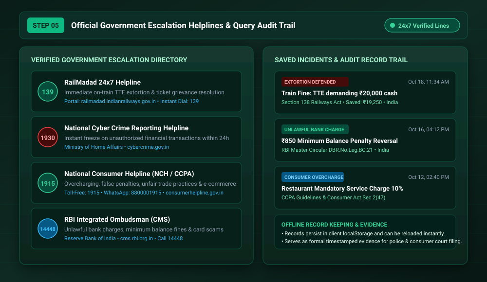

# RightPath

> **Know Your Rights. Make Confident Decisions.**  
> Real-time legal rights verification, statutory fine calculation, and anti-fraud defense system for citizens facing extortion, unlawful fines, and deceptive demands.

---

## Overview

RightPath gives citizens immediate statutory clarity when confronted with arbitrary penalties, aggressive demands, or consumer exploitation. Instead of searching through dense gazette notifications or arguing blindly with corrupt inspectors or call-center agents, citizens dictate or type their situation. RightPath checks the claim against official statutory acts, calculates the exact legal liability, issues a clear fraud verdict, and provides an assertive word-for-word resolution script with live voice readout.

```
+----------------------------------------------------------------------------------+
|                                RIGHTPATH ARCHITECTURE                            |
+----------------------------------------------------------------------------------+
                                         |
     [Citizen Incident Input]            |  1. Voice (Web Speech API) / Text
     - Spoken voice (Telugu, Hindi, etc) |  2. Dynamic Word Deduplication
     - Jurisdiction Context (India/State)|  3. Target Language Preference
                                         v
                      +--------------------------------------+
                      |      Express Server (/api/*)         |
                      +--------------------------------------+
                                         |
                 +-----------------------+-----------------------+
                 |                                               |
                 v                                               v
     [Primary: Gemini 3.6 Flash]                     [Secondary Fallback]
     - Grounded legal search                         - Gemini 2.5 Flash Hot-Swap
     - System prompt: Anti-fraud intelligence        - Local Statutory Knowledge Base:
     - Temp: 0.2 (deterministic legal precision)       * Indian Railways Act 1989 Sec 138
                                                       * RBI Circular DBR.No.Leg.BC.21
                                                       * Consumer Protection Act Sec 2(47)
                                         |
                                         v
                      +--------------------------------------+
                      |       Structured Report Pipeline     |
                      +--------------------------------------+
                      | 1. High-Impact Core Solution Banner  |
                      | 2. Extortion / Fraud Gap Verdict     |
                      | 3. Governing Law & Section Numbers   |
                      | 4. Exact Mathematical Fine Formula   |
                      | 5. Word-for-Word Resolution Script   |
                      | 6. Official 24x7 Verified Helplines  |
                      +--------------------------------------+
                                         |
                                         v
     [Client Delivery & Actions]
     - Responsive Markdown report with alert styling
     - Instant Copy Script & Copy Report
     - Browser SpeechSynthesis Web Audio (TTS) in user's language
     - Dynamic on-the-fly translation into 50+ languages
     - LocalStorage audit trail persistence
```

---

## Step-by-Step Application Workflow

RightPath guides the user through five distinct stages, from initial on-spot incident capture to resolution and official regulatory escalation.

---

### Step 1: Incident Capture & Multilingual Voice Input

Citizens facing immediate confrontation (e.g. at a railway platform, traffic checkpoint, or bank counter) can toggle between hands-free voice recording and manual text input. 



#### Key Operational Details:
- **Speech Recognition Engine:** Built on standard Web Speech API (`webkitSpeechRecognition` / `SpeechRecognition`) with continuous capture enabled.
- **Microphone Word Deduplication:** Raw recognition streams often duplicate phrases when continuous listening restarts or ambient noise fluctuates. RightPath uses an incremental suffix-matching filter to eliminate repeated chunks before rendering.
- **Language Selection:** Instant selection across 50+ regional and global languages (e.g., Telugu `te-IN`, Hindi `hi-IN`, Tamil `ta-IN`, English `en-IN`, Spanish, etc.).
- **Jurisdiction Binding:** Automatically binds the inquiry to the citizen's country and state (e.g., `India - Delhi`) so state-specific amendments and local circulars are respected.

---

### Step 2: Dual-Engine Statutory Research & Fraud Gap Analysis

Once the incident statement is submitted, RightPath dispatches the payload to `/api/verify-rights`. An animated step-indicator keeps the user informed while the system evaluates legal parameters.



#### Key Operational Details:
- **Domain Identification:** Classifies whether the scenario belongs to Transit/Railways, Banking & FinTech, Consumer Protection, Traffic Law, or Cyber Crime.
- **Multi-Tier Fault Tolerance:**
  1. *Primary Query:* Dispatches to `gemini-3.6-flash` with strict legal prompts (`temperature: 0.2`) and regulatory source grounding.
  2. *Secondary Hot-Swap:* Automatically switches to `gemini-2.5-flash` if upstream quotas or transient timeouts occur.
  3. *Zero-Quota Local Knowledge Base:* If no external network or API key is available, an offline statutory knowledge engine serves pre-compiled legal rules for common extortion scenarios (Railways Act 1989 Section 138, RBI Master Circulars, Consumer Act).
- **Fraud Gap Delta:** Quantifies the discrepancy between the corrupt demand and the legally published maximum penalty.

---

### Step 3: Comprehensive Anti-Fraud Verification Report

The verification report presents a legally structured, high-density breakdown designed for rapid comprehension under stress.



#### Report Sections:
1. **Core Solution & Immediate Action:** A bold, high-contrast banner summarizing the exact action in plain terms: what to pay, what to say, and what immediate action to take.
2. **Verdict & Fraud Alert Badge:** Explicit indicator (e.g., `🚨 HIGH EXTORTION ALERT`) directly calling out illegal cash requests.
3. **Official Laws, Rules & Section Numbers:** Precise statutory Act, Section, and Gazetted Circular references (e.g., *Section 138 of Indian Railways Act 1989*).
4. **Statutory Fee / Fine Breakdown:** Mathematical formula showing the base fare/fee plus the statutory excess cap (e.g., *Distance Fare ₹450 + Fixed ₹250 Excess Cap = ₹700 Total Maximum*).
5. **Mandatory Serialized Receipt:** Cites the specific government receipt requirement (e.g., *Excess Fare Ticket / EFT*) and reminds the user that paying without a serialized receipt is unlawful.
6. **Government Citations:** Direct hyperlinks to official government gazettes and regulatory websites.

---

### Step 4: Assertive Resolution Script & Text-to-Speech (TTS)

Citizens under pressure often feel intimidated or unsure of how to phrase legal objections. RightPath extracts a concise, assertive, word-for-word resolution script ready for immediate use.



#### Key Operational Details:
- **Direct Dialogue:** Pre-composed statement addressing the official politely yet firmly with statutory section references.
- **One-Click Script Copying:** Strips markdown formatting and copies pure speech-ready text into the device clipboard.
- **Browser Text-to-Speech (TTS):** Uses `window.speechSynthesis` to read the script aloud through the device loudspeaker, allowing the citizen to play the legal notice directly to the person demanding money.
- **Live Translation On-The-Fly:** Allows translating the entire report and script into any other language from the report view without re-running the legal verification query.

---

### Step 5: Official Escalation Helplines & Incident Audit Trail

When on-the-spot resolution fails or an official persists in demanding bribes or arbitrary cash, RightPath provides direct links and phone numbers to active 24x7 government oversight bodies.



#### Verified Escalation Helplines:
| Authority | Focus Area | Helpline Number | Official Portal |
| :--- | :--- | :--- | :--- |
| **RailMadad (Indian Railways)** | TTE Extortion, Overcharging, Train Complaints | **139** | [railmadad.indianrailways.gov.in](https://railmadad.indianrailways.gov.in) |
| **National Cyber Crime (MHA)** | Online Financial Fraud, UPI Scams, Impersonation | **1930** | [cybercrime.gov.in](https://cybercrime.gov.in) |
| **National Consumer Helpline (NCH / CCPA)** | Unfair Billing, Coercive Charges, Defective Goods | **1915** | [consumerhelpline.gov.in](https://consumerhelpline.gov.in) |
| **RBI Integrated Ombudsman** | Unlawful Bank Deductions, Minimum Balance Penalties | **14448** | [cms.rbi.org.in](https://cms.rbi.org.in) |
| **Central Vigilance Commission** | Anti-Bribery & Public Servant Corruption | **1064** | [cvc.gov.in](https://cvc.gov.in) |

#### Incident Audit History:
- Every analyzed query is recorded in local storage with timestamps, legal sections, detected fraud flags, and financial delta savings.
- Past reports can be re-opened instantly offline and serve as contemporaneous documentary evidence for consumer forum or police complaints.

---

## Technical Stack & Dependencies

- **Frontend:**
  - React 19 + TypeScript
  - Tailwind CSS v4
  - Motion (`motion/react`) for layout transitions
  - Lucide React for UI iconography
  - React Markdown for rendering structured statutory reports
  - Browser Web Speech API (`SpeechRecognition` & `SpeechSynthesis`)
- **Backend:**
  - Node.js + Express 5
  - `@google/genai` TypeScript SDK (`gemini-3.6-flash` / `gemini-2.5-flash`)
  - Vite dev server middleware in development mode (`tsx server.ts`)
- **Data & Localization:**
  - ISO language mappings for 50+ languages with regional BCP-47 speech codes
  - Comprehensive list of countries and states/provinces

---

## API Endpoints

### 1. `POST /api/verify-rights`
Main anti-fraud intelligence and rights verification endpoint.

**Request Body:**
```json
{
  "query": "Travelling in sleeper coach without ticket. TTE is demanding ₹20,000 cash fine.",
  "country": "India",
  "state": "Delhi",
  "category": "Automated Domain Analysis",
  "preferredLanguage": "English",
  "userProfile": {
    "firstName": "Anand",
    "lastName": "Sharma"
  }
}
```

**Response Body:**
```json
{
  "success": true,
  "report": "💡 **CORE SOLUTION & IMMEDIATE ACTION (HIGHLIGHTED):**\n...",
  "sources": [
    {
      "title": "Official Indian Railways Act 1989 (Section 138 & 137)",
      "url": "https://indianrailways.gov.in"
    }
  ],
  "searchQueries": [],
  "timestamp": "2026-10-18T18:30:00.000Z"
}
```

### 2. `POST /api/calculate-railway-fine`
Deterministic calculator for Section 138 train ticket excess charges.

**Request Body:**
```json
{
  "distanceKm": 800,
  "trainType": "Express",
  "coachClass": "Sleeper",
  "baseFareKnown": 0
}
```

**Response Body:**
```json
{
  "trainType": "Express",
  "coachClass": "Sleeper",
  "distanceKm": 800,
  "estimatedBaseFare": 480,
  "excessCharge": 250,
  "totalStatutoryFine": 730,
  "ruleName": "Section 138 of Indian Railways Act, 1989",
  "receiptMandate": "The T.C / TTE MUST issue an official Excess Fare Ticket (EFT) receipt with serial number.",
  "helpline": "RailMadad 139 / Dial 139"
}
```

---

## Local Development & Setup

### Prerequisites
- Node.js 20+
- npm 10+
- Gemini API key (optional for local testing; built-in fallback knowledge engine provides offline responses if key is absent).

### Installation
```bash
# Clone the repository
git clone https://github.com/example/rightpath.git
cd rightpath

# Install dependencies
npm install

# Set up environment variables
cp .env.example .env
# Edit .env and supply GEMINI_API_KEY if desired:
# GEMINI_API_KEY="your-gemini-api-key"
```

### Running Locally
```bash
# Starts Express server mounted with Vite middleware on http://localhost:3000
npm run dev
```

### Building for Production
```bash
# Compile frontend production bundle
npm run build

# Start production server
npm start
```

---

## License

RightPath is distributed under the MIT License.
